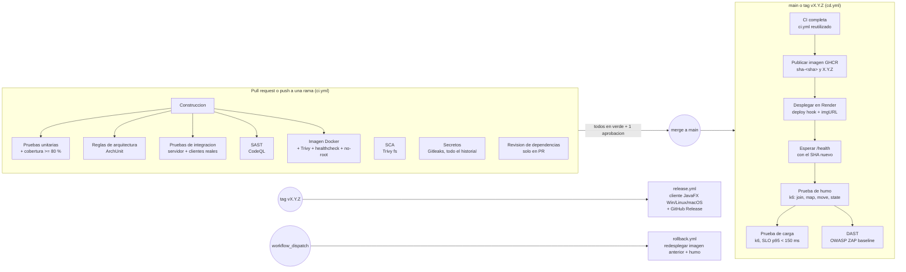

# DevOps: pipeline, etapas, umbrales y reversión

Cómo llega un cambio desde un commit hasta producción, qué verifica cada etapa, qué umbral la detiene y por qué se eligió ese valor. La estrategia de despliegue está en [ADR-004](adr/ADR-004-estrategia-de-despliegue.md) y la de seguridad en [ADR-005](adr/ADR-005-seguridad-del-pipeline.md).

## 1. Flujo de trabajo

- **GitHub Flow.** Cada cambio nace en una rama (`feature/...`, `fix/...`, `ci/...`, `docs/...`) y entra a `main` solo por pull request.
- **`main` protegida con un ruleset** (Settings → Rules → Rulesets → `main`):
  - pull request obligatorio con **al menos 1 aprobación de otro integrante**;
  - las aprobaciones se descartan si llega un commit nuevo;
  - todos los checks de `ci.yml` son obligatorios;
  - el historial queda lineal, sin force push y sin borrar la rama.
- **Versionado semántico.** Cada versión se marca con un tag `vX.Y.Z` sobre `main`. `release.yml` publica el GitHub Release con las notas de [CHANGELOG.md](../CHANGELOG.md), y `cd.yml` publica la imagen con esa versión.

## 2. Diagrama del pipeline



Otros workflows:

| Workflow | Cuándo | Qué hace |
|---|---|---|
| `perf.yml` | Manual (`workflow_dispatch`) y los lunes | Prueba de carga larga contra producción con los mismos *thresholds* |
| `k8s.yml` | PR y `main` que tocan `k8s/`, el Dockerfile o el código | Despliega en kind y verifica probes, humo y NetworkPolicy (bonificación) |
| `release.yml` | Tag `vX.Y.Z` | Compila el cliente en tres sistemas operativos y crea el Release |
| `rollback.yml` | Manual | Vuelve a desplegar una imagen anterior y corre la prueba de humo |

## 3. Etapas, umbrales y por qué

| Etapa (check) | Qué verifica | Se detiene cuando… | Por qué ese valor |
|---|---|---|---|
| **Construcción** | `mvn test-compile`: el código y las pruebas compilan y las dependencias se resuelven | No compila | — |
| **Pruebas unitarias y cobertura** | 45 pruebas del dominio, el caso de uso, el catálogo JSON, el builder y el DAO. JaCoCo `check` en la fase `test` | Falla una prueba, o la cobertura de líneas de `domain` + `application` queda **por debajo del 80 %** | El enunciado pide 70 %. Hoy el dominio supera el 90 %, así que 80 % deja margen para cambios sin permitir que la cobertura se degrade. El umbral está en `pom.xml` (`coverage.domain.minimum`) |
| **Reglas de arquitectura** | 5 reglas ArchUnit que salen de los ADR (sección 4 del README) | Se viola una regla de dependencias | Cero tolerancia: una frontera rota es una decisión de arquitectura revertida sin ADR |
| **Pruebas de integración** | `MultijugadorIT`: servidor Javalin real y clientes WebSocket reales. Difusión, rechazos, desconexión, controles A-01 a A-05, `/health` y `/metrics` | Falla una prueba | — |
| **Seguridad - SAST** | CodeQL `security-extended` | Hallazgo con severidad ≥ 7.0 sin tratar | ADR-005 |
| **Seguridad - SCA** | Trivy sobre las dependencias resueltas | CVE alto o crítico con corrección | ADR-005 |
| **Revisión de dependencias del PR** | Dependencias **nuevas** del PR | CVE alto o crítico | Bloquea antes de llegar a main |
| **Seguridad - secretos** | Gitleaks sobre todo el historial | Un secreto | Cero, incluido el historial |
| **Imagen Docker y escaneo** | Construye la imagen, la escanea, la arranca, espera `/health` y comprueba que el UID no sea 0 | CVE alto o crítico con corrección, el contenedor no arranca o corre como root | Más estricto que el enunciado (que pide solo crítico) |
| **Publicar imagen** | Push a GHCR con `sha-<sha>` y, con tag, `X.Y.Z` y `X.Y`. SBOM y procedencia | Falla el push | Nunca `latest` |
| **Desplegar en Render** | Deploy hook con `imgURL` y espera de `/health` con el SHA | Render rechaza el despliegue, o en 10 minutos no responde la versión nueva | 10 minutos cubren el arranque en frío del plan gratuito (unos 60 s) y la descarga de la imagen |
| **Prueba de humo** | k6: `/health` UP con la versión, `join` con el código de sala, `map` de 50×50, `move` a una casilla vecina y `state` con la nueva posición | Falla cualquier *check* (`checks: rate==1`) | El flujo principal tiene que funcionar siempre |
| **Prueba de carga (SLO)** | k6 con 8 jugadores durante 1 minuto, un movimiento cada 200 ms | **p95 de `move_latency` ≥ 150 ms**, o **≥ 1 %** de movimientos sin confirmar, o una conexión fallida | Es el SLO del ADR-001. 8 jugadores es el escenario `oficial-carga` del Corte 2, acortado a 1 minuto para no alargar el pipeline. La prueba larga va en `perf.yml` |
| **DAST** | ZAP baseline contra la URL pública | Alerta WARN o FAIL no tratada en `.zap/rules.tsv` | Bonificación; mismo tratamiento de hallazgos que los demás controles |

**Tiempos.** La CI corre en paralelo tras la construcción y tarda unos 6 a 8 minutos con la caché de Maven (`setup-java cache: maven`) y la caché de capas de Docker (`type=gha`). Queda por debajo del límite de 10 minutos. El despliegue, el humo, la carga y ZAP suman unos 5 minutos más.

**Reportes.** Cada ejecución publica como artefactos:

- `reportes-pruebas-unitarias` (Surefire y JaCoCo HTML);
- `reportes-pruebas-integracion`, `reporte-arquitectura`;
- `reporte-sast`, `reporte-sca`, `reporte-secretos`, `reporte-imagen`;
- `reporte-humo`, `reporte-carga`, `reporte-dast`.

## 4. Secretos y variables

En **Settings → Environments → `production`**. Nada de esto está en el repositorio.

| Nombre | Tipo | Para qué |
|---|---|---|
| `RENDER_DEPLOY_HOOK_URL` | Secret | Deploy hook del servicio en Render (Settings → Deploy Hook) |
| `JOIN_CODE` | Secret | Código de sala. El mismo valor configurado en Render. Lo usan la prueba de humo y la de carga |
| `APP_URL` | Variable | URL pública, por ejemplo `https://rpg-servidor.onrender.com` |

`GITHUB_TOKEN` (automático) publica en GHCR.

## 5. Reversión

Las imágenes de todas las versiones siguen en GHCR, así que volver atrás es **volver a desplegar una imagen que ya pasó el pipeline**, sin reconstruir nada.

### Procedimiento

1. Identificar la versión buena: la última de [Releases](../../releases) o el SHA de la última ejecución verde de `CD`.
2. En **Actions → Rollback → Run workflow**, escribir:
   - `version`: la etiqueta de la imagen, por ejemplo `1.0.0` o `sha-<sha completo>`;
   - `reason`: el motivo.
3. El workflow:
   - comprueba que la imagen existe en GHCR;
   - lee el SHA que lleva dentro (`APP_VERSION`);
   - llama al deploy hook con esa imagen;
   - espera a que `/health` devuelva ese SHA;
   - corre la prueba de humo.
4. Si la prueba de humo pasa, la reversión terminó. Después se corrige el defecto en una rama y se fusiona como cualquier otro cambio. El siguiente `CD` vuelve a desplegar la versión corregida.

Sin GitHub Actions disponible, el mismo efecto se logra desde una terminal:

```bash
RENDER_DEPLOY_HOOK_URL='<hook>' bash scripts/render-deploy.sh ghcr.io/vykymoon/rpg-servidor:1.0.0
bash scripts/wait-for-health.sh https://<servicio>.onrender.com
```

### Registro de reversiones probadas

| Fecha | De → a | Ejecución | Resultado |
|---|---|---|---|
| _(se completa al ejecutar `rollback.yml`)_ | | | |

## 6. Evidencias para la calificación

| Qué | Dónde |
|---|---|
| Ejecuciones por push y PR, con un check por etapa | Pestaña Actions → `CI`; cualquier PR → Checks |
| Pipeline completo de `main` (CI → despliegue → humo → carga → DAST) | Actions → `CD` |
| Ruleset de `main` | Settings → Rules → Rulesets |
| PR aprobado por otro integrante | Pestaña Pull requests (cerrados) |
| PR bloqueado por los controles de seguridad | Enlazado en [docs/seguridad.md §5](seguridad.md#5-evidencia-de-que-los-controles-bloquean) |
| Imagen con SHA y versión | Packages → `rpg-servidor` |
| Reversión ejecutada | Actions → `Rollback`, y la tabla de la sección 5 |
| Versiones y cliente | Releases |
