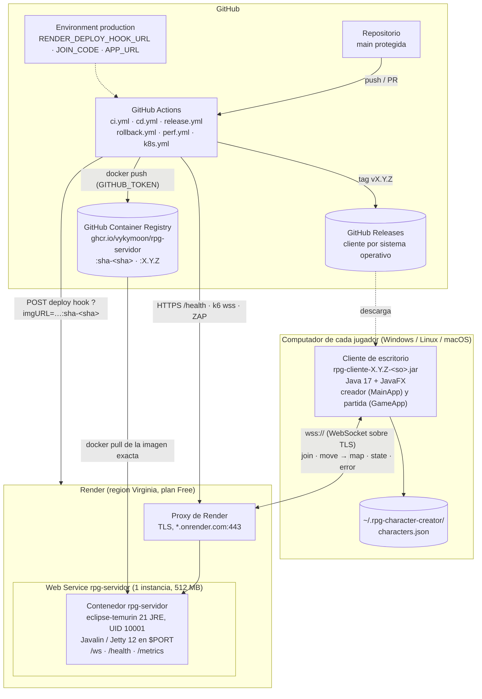
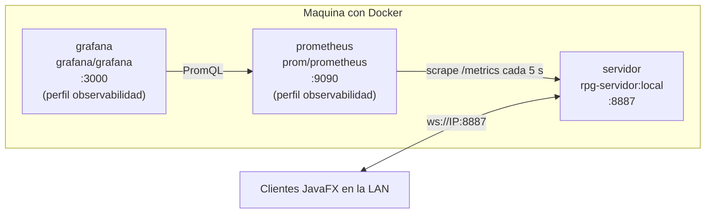
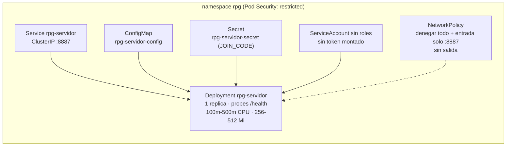

# Vista de despliegue (C4: despliegue)

Muestra dónde corre cada contenedor del sistema y cómo se comunican. Corresponde a lo que despliegan `cd.yml` (producción en Render), `docker-compose.yml` (local) y `k8s.yml` (Kubernetes en kind). Las decisiones están en [ADR-004](../adr/ADR-004-estrategia-de-despliegue.md).

## Producción

| Elemento | Tecnología | Dónde corre | Se comunica con |
|---|---|---|---|
| Cliente de escritorio | Java 17, JavaFX 21, Java-WebSocket | PC de cada jugador; se descarga de Releases | Servidor por `wss://<servicio>.onrender.com/ws` (o `ws://IP:8887` en LAN) |
| Servidor de partida | Contenedor `rpg-servidor`: JRE 21, Javalin 7 / Jetty 12 | Render, Web Service basado en imagen, una instancia | Clientes (WebSocket) y el pipeline (HTTP `/health`, `/metrics`) |
| Proxy de Render | Gestionado por Render | Render | Termina TLS y reenvía HTTP y WebSocket al `$PORT` del contenedor |
| Registro de imágenes | GHCR | GitHub | Recibe la imagen de `cd.yml`; Render la descarga |
| Pipeline | GitHub Actions (runners `ubuntu-latest`) | GitHub | Publica, despliega, prueba (k6, ZAP) y revierte |

## Local (docker compose)

`servidor` tiene un healthcheck sobre `/health`, y `prometheus` espera a que esté sano (`depends_on: condition: service_healthy`).

## Kubernetes (kind, bonificación)

